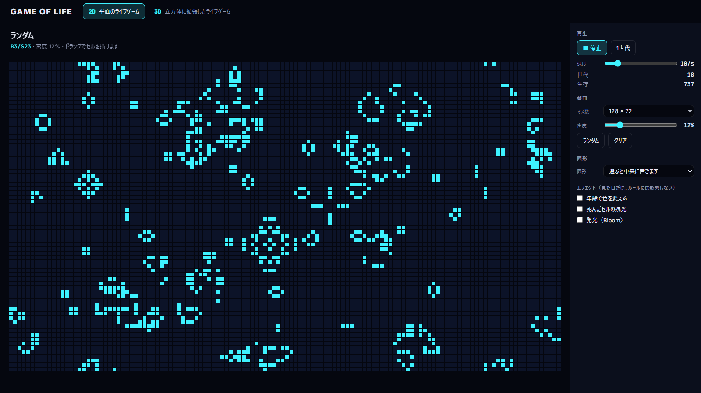
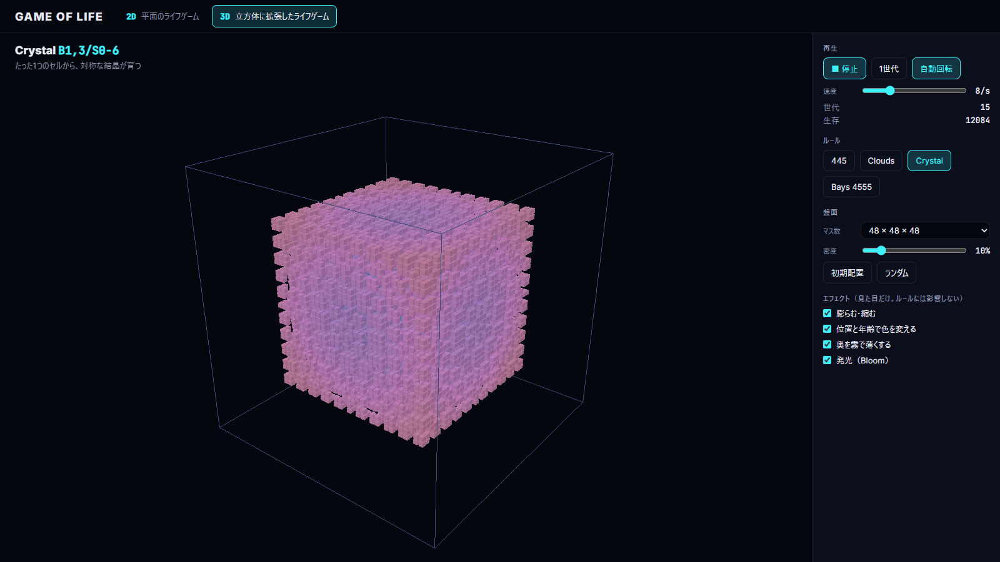

[English](README.en.md) | 日本語

# Game of Life — 2D / 3D

コンウェイのライフゲームを Three.js で作り、さらに三次元に拡張したサンプルです。\
画面上部のメニューで 2D と 3D を切り替えて遊べます。\
YouTube チャンネル「エレキベアのデジタルラボ」で紹介しています。

- **ブラウザで触る**: 
  - [lab.elekibear.com/demos/game-of-life/](https://lab.elekibear.com/demos/game-of-life/)

| | |
|---|---|
|  |  |
| **2D** — コンウェイのライフゲーム | **3D** — 三次元に拡張したライフゲーム |

## できること

- **2D**
  - マス数を選べる（48×27〜256×144）
  - ランダムに配置できる（確率を選べる）
  - 図形を 35 種から置ける（固定物体・振動子・宇宙船・銃・メトセラ・無限成長）
  - 全図形が動く一覧モード
  - ドラッグでセルを描ける
- **3D**
  - マス数を選べる（16³〜96³）
  - ランダムに配置できる（確率と範囲を選べる）
  - ルールを 11 種のプリセットから選べる（死にかけの段階を持つ Generations ルールを含む）
- **エフェクト**
  - 色の変化・残光・膨らむ/縮む・霧・発光を付けられる
  - どれも最初はオフで、ルールどおりの生死だけが見える

## 技術構成

- React 19
- TypeScript
- Vite
- Three.js
- Vitest
- Prettier

## 起動方法

**必要なもの**

- [Node.js](https://nodejs.org/) 22.12 以上

リポジトリのフォルダで、次のコマンドを実行します。

```bash
npm install
npm run dev
```

表示された URL（通常は `http://localhost:5173/`）をブラウザで開きます。

右上の「JA | EN」を押すか、URL に `?lang=en` を付けると英語で表示します。末尾を `#3d` にすると 3D の画面から開きます（`?lang=en#3d` のように一緒に使えます）。

## フォルダ構成

```
src/
  core/      ライフゲームのコアロジック。まずここを読む
  data/      2D の図形 35 種・3D のルール 11 種
  view2d/    2D の画面
  view3d/    3D の画面
  ui/        2D と 3D で共通の部品
  shared/    キーボード操作・言語
tests/       テストコード
```

## コードの読みどころ

ライフゲームのロジックは `src/core/` の 3 ファイル、そこで動かす図形とルールは `src/data/` の 2 ファイルにまとまっています。どちらもフレームワークに依存しない処理のため、読むと主な実装が分かります。

コード中のコメントは英語です。日本語のコメント付きで読みたい人は、主なコードを抜き出して解説している [実装解説](docs/implementation-guide.md) をどうぞ。

1. **[`src/core/life2d.ts`](src/core/life2d.ts)** — 盤面・周りの 8 マスを数える・1 世代進める
2. **[`src/core/life3d.ts`](src/core/life3d.ts)** — 同じ順に並べた 3D 版。近傍が 26 マスになる
3. **[`src/core/rule.ts`](src/core/rule.ts)** — 「B3/S23」のようなルールの書き方。2D と 3D で共通
4. **[`src/data/patterns.ts`](src/data/patterns.ts)** — 2D の図形 35 種
5. **[`src/data/presets.ts`](src/data/presets.ts)** — 3D のルール 11 種

中心になるのは、1 世代進めるこの関数です。

```ts
export function step(grid: Grid, rule: Rule = CONWAY): Grid {
  const next = createGrid(grid.width, grid.height);
  for (let y = 0; y < grid.height; y++) {
    for (let x = 0; x < grid.width; x++) {
      const i = y * grid.width + x;
      const count = countNeighbors(grid, x, y);
      const alive = grid.cells[i] === ALIVE;
      const lives = alive ? rule.survive.includes(count) : rule.birth.includes(count);
      next.cells[i] = lives ? ALIVE : DEAD;
    }
  }
  return next;
}
```

2D と 3D のファイルは同じ順に並べているので、横に並べると「3D で何が変わったか」がそのまま読めます。\
画面（`src/view2d/`・`src/view3d/`）は、`core` の結果を Three.js で描いているだけです。

## 3D のルールの出典

3D のプリセットは、Carter Bays 氏の研究で見つかったルールと、Softology の Jason Rampe 氏が名前を付けて紹介しているルールから用意しています。詳細は、参考文献をご参照ください。

| プリセット | このサンプルのルール | 出典 | 種類 |
|---|---|---|---|
| Bays 4555 | B5/S4-5 | Carter Bays (1987) [1] | 2 状態 |
| Bays 5766 | B6/S5-7 | Carter Bays (1987) [1] | 2 状態 |
| 445 | B4/S4 | Jason Rampe / Softology (2019) [2] | 2 状態（原典は 5 状態の `4/4/5/M`） |
| Clouds | B13-14,17-19/S13-26 | 同上（原典の名前は Clouds 1） | 2 状態 |
| Crystal | B1,3/S0-6 | 同上（原典の名前は Crystal Growth 1） | 2 状態（原典は周り 6 マスで数える。ここでは 26 マス） |
| Architecture | B3/S4-6 | 同上 | 2 状態 |
| Pyroclastic | B6-8/S4-7/C10 | 同上 | Generations（10 状態） |
| Coral | B6-7,9,12/S5-8/C4 | 同上 | Generations（4 状態） |
| Amoeba | B5-7,12-13,15/S9-26/C5 | 同上 | Generations（5 状態） |
| Pulse Waves | B1-3/S3/C10 | 同上 | Generations（10 状態） |
| Builder | B4,6,8-9/S2,6,9/C10 | 同上（原典の名前は Builder 1） | Generations（10 状態） |

**参考文献**

1. Carter Bays, "Candidates for the Game of Life in Three Dimensions", *Complex Systems* 1 (1987)
2. Jason Rampe (Softology), "3D Cellular Automata" (2019) — <https://softologyblog.wordpress.com/2019/12/28/3d-cellular-automata-3/>
3. Carter Bays, "A Note About the Discovery of Many New Rules for the Game of Three-Dimensional Life", *Complex Systems* 16 (2006)

## ドキュメント

- [実装解説](docs/implementation-guide.md) — ルール・2D の実装・3D への拡張・描画の工夫を順に解説
- [コードガイド](docs/code_guide.md) — 手を入れるときの決まり
