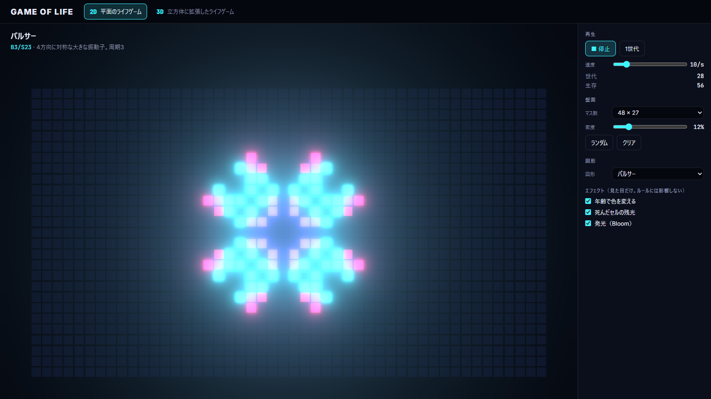
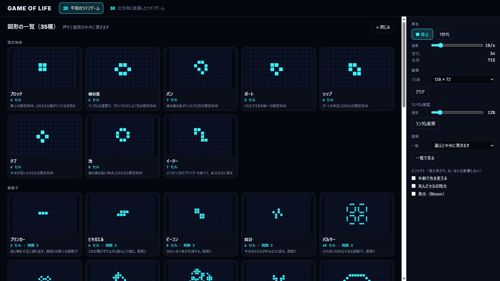
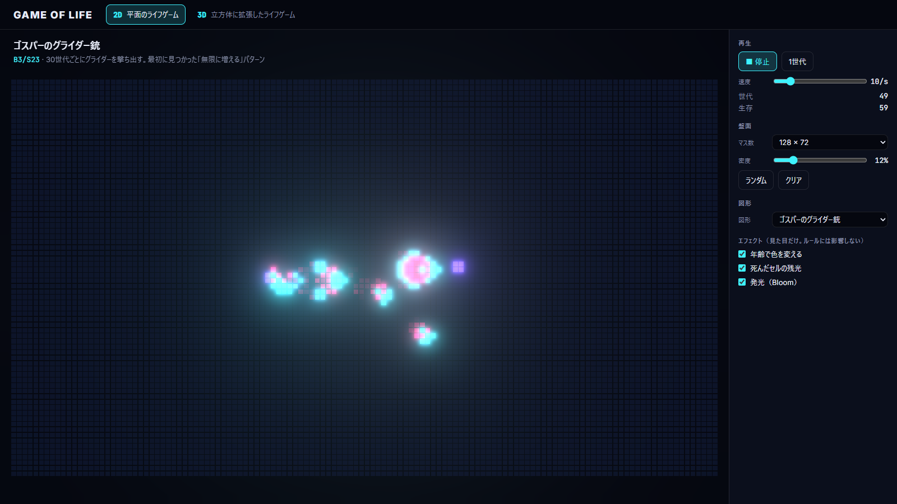
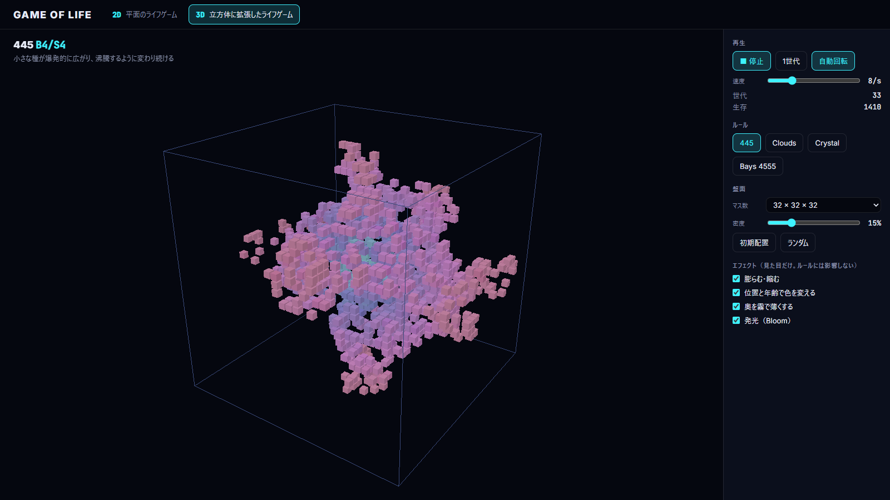
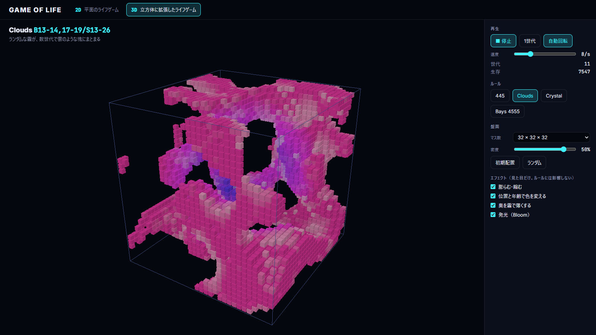
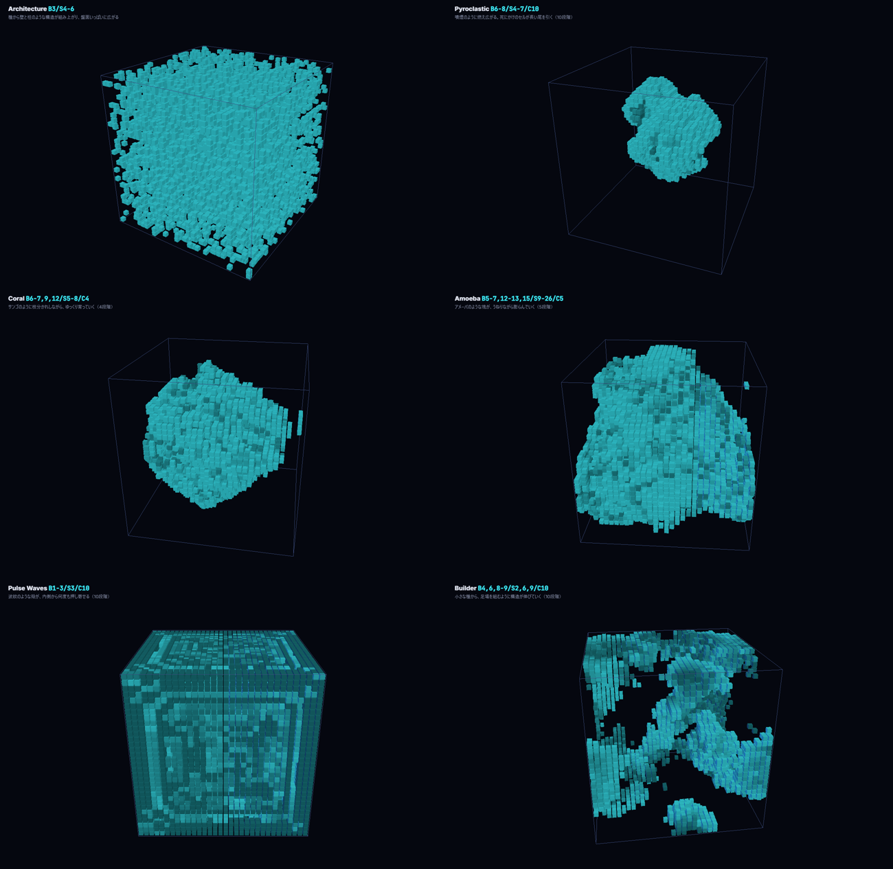
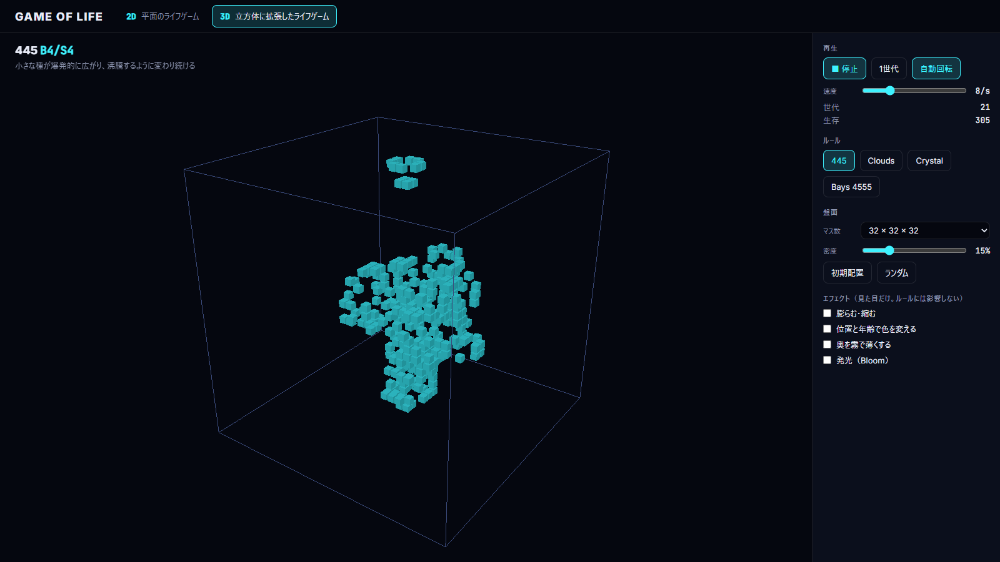

English | [日本語](implementation-guide.md)

# Game of Life in Three.js — Implementation Guide

We build Conway's Game of Life in 2D with Three.js, then extend it to three dimensions to see what happens.
Inside one app, the menu at the top switches between 2D and 3D.

- **2D** … Conway's Game of Life. Pick from 35 well-known patterns in an animated catalog and place them on the board
- **3D** … A 3D version with the neighbourhood widened to 26 cells. Runs 11 rules on boards of up to 96³


---

## 1. The rules of the Game of Life

Each cell on the grid is either "alive" or "dead". The next generation depends on how many of the 8 surrounding cells are alive.

| Current state | Live neighbours | Next generation |
|---|---|---|
| Dead | exactly 3 | **Birth** |
| Alive | 2 or 3 | **Survives** |
| Alive | 1 or fewer / 4 or more | Dies (underpopulation / overpopulation) |

This rule is written **B3/S23** (Birth 3 / Survive 2,3).
In the 3D version, you change the rule just by swapping these numbers.

The edges of the board wrap around to the opposite side (a torus). A glider that reaches the edge comes back in from the other side.

---

## 2. Overall structure

React builds the screen and the control panel, while drawing is written directly against the Three.js API (no React Three Fiber).

```
src/
  core/                 The Game of Life logic (no React, no three). Start reading here
    life2d.ts            Board, counting neighbours, stepping one generation
    life3d.ts            The 3D version (laid out in the same order as life2d.ts)
    rule.ts              Birth and survival conditions (shared by 2D and 3D)
  data/
    patterns.ts          The 2D pattern catalog (35 patterns)
    presets.ts           3D rules and starting cells (11 presets)
  view2d/               The 2D screen
    Life2D.tsx           Holds the state and puts the canvas and panel together
    seed.ts              Builds the board from a starting layout
    components/          React components
      LifeCanvas.tsx
      ControlPanel.tsx
    scene/               Three.js drawing (runs outside React)
      useLifeScene.ts     Draw loop and board management
      createStage.ts      Renderer, camera, Bloom
      cellMesh.ts         Draws the cells with an InstancedMesh
    gallery/             The pattern catalog (2D only)
  view3d/               The 3D screen (same layout)
  ui/                   Buttons, sliders, screen frame and other parts shared by 2D and 3D
  shared/               Keyboard shortcuts and language (shared code that is not a component)
  App.tsx               Title and the 2D / 3D menu. Only shows the chosen screen
public/favicon.svg      Icon showing a glider
```

Dependencies go one way only: `core → data → view2d / view3d → App`. `view2d` and `view3d` do not know about each other.
Because 2D and 3D are **split into files laid out the same way**, putting them side by side shows exactly what changed.

The data flows like this:

```
 ControlPanel ──(button)──▶ Life2D ──ref.step() / ref.load(grid)──▶ useLifeScene
                              ▲                                        │
                              └───── onStats(generation, alive) ───────┘
                                                                       │ every frame
                                                       core/step()   ◀─┤
                                                       cellMesh.tick() ◀┘ → screen
```

**Key point:** the board is not kept in React state. A value that changes every generation would trigger a React re-render each time, and would also be managed twice alongside the requestAnimationFrame draw loop. The board lives in a `useRef`, and only "generation and live count" are handed back to React.

---

## 3. The 2D version

### 3-1. The board is a 1D array

```ts
// core/life2d.ts
export type Grid = {
  width: number;
  height: number;
  cells: Uint8Array; // 0 = dead, 1 = alive. Ordered as y * width + x
};

export function indexOf(grid: Grid, x: number, y: number): number {
  const wx = (x + grid.width) % grid.width; // wrap to the opposite side
  const wy = (y + grid.height) % grid.height;
  return wy * grid.width + wx;
}
```

It is faster to create and copy than a 2D array, and can be passed straight to the draw loop.
Wrapping with `% width` removes any special handling for the edges.

### 3-2. Stepping one generation

```ts
// core/life2d.ts
// Count the live cells in the 8 cells around (x, y)
export function countNeighbors(grid: Grid, x: number, y: number): number {
  let count = 0;
  for (let dy = -1; dy <= 1; dy++) {
    for (let dx = -1; dx <= 1; dx++) {
      if (dx === 0 && dy === 0) {
        continue; // skip the cell itself
      }
      count += grid.cells[indexOf(grid, x + dx, y + dy)];
    }
  }
  return count;
}

// Return a new board, one generation later
export function step(grid: Grid, rule: Rule = CONWAY): Grid {
  const next = createGrid(grid.width, grid.height); // write to a new board, not the old one
  for (let y = 0; y < grid.height; y++) {
    for (let x = 0; x < grid.width; x++) {
      const i = y * grid.width + x;
      const count = countNeighbors(grid, x, y);
      const alive = grid.cells[i] === ALIVE;
      // alive: check the survive counts. dead: check the birth counts
      const lives = alive ? rule.survive.includes(count) : rule.birth.includes(count);
      next.cells[i] = lives ? ALIVE : DEAD;
    }
  }
  return next;
}
```

All cells must update "at the same time", so the old board is never modified; the result goes into a new board.
This is a pure function with nothing to do with Three.js, so `tests/life2d.test.ts` tests it directly: "a blinker returns after 2 generations", "a glider moves one cell diagonally in 4 generations", and so on.

### 3-3. The pattern catalog

`data/patterns.ts` lists 35 well-known named patterns, grouped by category. Each pattern is stored as one string per row, so it can be written "as it looks".

```ts
{
  id: 'glider',
  name: { ja: 'グライダー', en: 'Glider' },
  category: 'spaceship',
  description: {
    ja: '4世代で斜めに1マス進む、最小の宇宙船',
    en: 'The smallest spaceship. Moves one cell diagonally every 4 generations',
  },
  rows: ['.O.', '..O', 'OOO'],
  period: 4,
}
```

| Category | What happens | Patterns included |
|---|---|---|
| Still lifes | Never change, however many generations pass | Block, Beehive, Loaf, Boat, Ship, Tub, Pond, Eater |
| Oscillators | Return to their original shape after a fixed period | Blinker (2), Toad (2), Beacon (2), Clock (2), Pulsar (3), Octagon (5), Figure eight (8), Kok's galaxy (8), Tumbler (14), Pentadecathlon (15), Queen bee shuttle (30) |
| Spaceships | Move while keeping their shape | Glider, Lightweight / Middleweight / Heavyweight spaceship, Copperhead |
| Guns | Keep firing spaceships | Gosper glider gun, Simkin glider gun |
| Methuselahs | Small seeds that keep changing for a long time | R-pentomino, Diehard, Acorn, B-heptomino, Pi-heptomino, Rabbits |
| Infinite growth | Grow without limit on a large enough board | 10-cell, 5×5 and one-row infinite growth |

(Periods in parentheses)

For patterns with a `period`, `tests/patterns.test.ts` **actually runs them** and checks that they return to the same shape at exactly that generation. Spaceships move, so only the contents of the rectangle around the live cells are compared. The test also catches a single mistyped cell in a hand-written pattern.



#### Catalog mode

Placing 35 patterns one by one to check them is tedious, so "Browse all" (L key) shows every pattern side by side. Each card loops its pattern, and clicking one places it in the centre of the board and closes the catalog.



The small boards in the catalog are drawn with **Canvas 2D**, not Three.js. A browser can only hold a dozen or so WebGL contexts at once, so creating a WebGLRenderer for each of the 35 cards would run out. The board itself is computed with the same `step()` from `core/life2d.ts` as the main board.

```ts
// view2d/gallery/preview.ts (excerpt)
const MARGIN: Record<PatternCategory, number> = {
  still: 3, // still lifes and oscillators: tight, so they look big
  oscillator: 5,
  spaceship: 12, // spaceships and methuselahs: wide, so you can see them move
  gun: 12,
  methuselah: 24,
  growth: 24,
};
```

The margin around each pattern depends on its category: still lifes are shown large, spaceships with enough room to see them travel.

### 3-4. The Three.js stage (createStage)

```ts
// view2d/scene/createStage.ts (excerpt)
const renderer = new WebGLRenderer({ canvas, antialias: true });
const scene = new Scene();
const camera = new OrthographicCamera(); // 2D, so no perspective. 1 cell = 1 unit

const composer = new EffectComposer(renderer);
composer.addPass(new RenderPass(scene, camera));
const bloom = new UnrealBloomPass(new Vector2(1, 1), 0.7, 0.35, 0.15);
composer.addPass(bloom);
composer.addPass(new OutputPass());
```

- **OrthographicCamera** … shows the 2D board without distortion. `resize` sets the camera's range so the whole board fits inside the margins. One cell is rounded down to a **whole number of screen pixels**, and the board's top left corner is put on a pixel edge too (with an in-between size like 5.3 px, cells and gaps differ by 1 px here and there, and the grid looks uneven)
- **UnrealBloomPass** … blurs bright areas so the cells appear to glow. Turned on and off with `bloom.enabled`
- **OutputPass** … colour space conversion. Put it last when using post-processing

### 3-5. Drawing every cell with one InstancedMesh

128 × 72 = 9,216 cells. One Mesh per cell would mean 9,216 draw calls, but an InstancedMesh needs **just one**. The shape (a flat plane) and the material are shared, and each instance only carries a "position" and a "colour".

```ts
// view2d/scene/cellMesh.ts (excerpt)
// A 1 × 1 plane that starts at its top left corner. It is placed at the top left of each cell, so the gap is on the right and bottom
const geometry = new PlaneGeometry(1, 1).translate(0.5, -0.5, 0);
const mesh = new InstancedMesh(geometry, new MeshBasicMaterial(), count);

// Positions and size are set only when the screen size changes
dummy.scale.set(size, size, 1);
dummy.position.set(x - width / 2, height / 2 - y, 0);
dummy.updateMatrix();
mesh.setMatrixAt(i, dummy.matrix);

// Every frame, only the colours are repainted
mesh.setColorAt(i, color);
mesh.instanceColor!.needsUpdate = true;
```

Drawing each cell a little smaller leaves a gap, and drawing dead cells slightly brighter than the background shows the grid without drawing separate grid lines. The gap is about 14% of a cell, rounded to **whole pixels**, so it is the same width at any screen size.

### 3-6. Effects are "optional"

With no effects, cells have only two colours: **alive = cyan / dead = dark navy**. This is the easiest to read when following how the rules play out, so every effect starts off. The checkboxes in the panel add purely visual effects.

| Effect | What it does |
|---|---|
| Colour by age | The longer a cell lives, the more it shifts from cyan `#3ef2ff` to purple `#7b5cff` (fully shifted after 16 generations) |
| Afterglow of dead cells | Cells that just died glow pink `#ff3d9a` and fade over 0.8 seconds |
| Glow (Bloom) | Blurs the bright cells |

```ts
// tick in view2d/scene/cellMesh.ts (excerpt)
if (age[i] > 0 && effects.age) {
  color.lerpColors(YOUNG, OLD, (age[i] - 1) / MATURE_AGE);
} else if (age[i] > 0) {
  color.copy(YOUNG);
} else if (effects.trail && fade[i] > 0) {
  color.lerpColors(EMPTY, TRAIL, fade[i] * fade[i]); // squared, so it trails off
} else {
  color.copy(EMPTY);
}
```

Every effect lives **only inside the drawing code** and never touches the logic in `core/`. With all effects on, the parts that keep moving glow cyan, settled shapes turn purple, and movement leaves pink trails.



### 3-7. Connecting to React (useLifeScene)

```ts
// view2d/scene/useLifeScene.ts (key points)
const gridRef = useRef(initialGrid);
const optionsRef = useRef(options);
optionsRef.current = options; // the draw loop always reads the latest props

useEffect(() => {
  const stage = createStage(canvas, width, height);
  const cells = createCellMesh(width, height);
  stage.scene.add(cells.mesh);

  const loop = (now: number) => {
    const { running, interval, effects } = optionsRef.current;
    // if running, step() every interval seconds
    cells.tick(delta, effects);
    stage.setBloom(effects.bloom);
    stage.render();
    frame = requestAnimationFrame(loop);
  };
  frame = requestAnimationFrame(loop);

  return () => {
    /* clean up with cancelAnimationFrame and dispose */
  };
}, [canvasRef]);
```

- The scene is created **only once**. Changing playback, speed or effects does not rebuild it; the latest values are read through a ref
- On unmount, `dispose()` frees the GPU resources (no leak even with StrictMode's double run)
- Commands from the screen arrive through `{ step, load }`, passed to the ref of `LifeCanvas`

### 3-8. Changing the board size

Changing the board size changes both the camera range and the number of cells. Rebuilding is simpler than adjusting everything in place, so the board size goes into the `key` of `LifeCanvas` and **the whole canvas is rebuilt**.

```tsx
<LifeCanvas key={`${boardSize.width}x${boardSize.height}`} initialGrid={initialGrid} … />
```

So that the board's contents carry over, the screen remembers **how the board was made** (`Seed`) rather than the board itself.

```ts
// view2d/seed.ts
export type Seed =
  { kind: 'random'; density: number } | { kind: 'pattern'; pattern: Pattern } | { kind: 'empty' };
```

If you change the size while a glider gun is placed, a glider gun is placed again in the centre of the new board.

### 3-9. Random fill density

The **density** of "Random fill" is the probability that a cell starts alive (12% by default). While a random board is shown, moving the slider immediately refills it at that density, so you can compare densities on the spot.

### 3-10. Drawing cells by dragging

With an orthographic camera, screen position → board coordinates is one line: `Vector3.unproject(camera)`. If the cell under the pointer is dead, you "draw"; if it is alive, you "erase".

---

## 4. Extending to 3D

### 4-1. What changes

| | 2D | 3D |
|---|---|---|
| Board | 128 × 72 = 9,216 (48×27 to 256×144) | 32 × 32 × 32 = 32,768 (16³ to 96³) |
| Index | `y * w + x` | `x + y * s + z * s * s` |
| Neighbours | 8 cells | **26 cells** (3 × 3 × 3 − 1) |
| Rule notation | `B3/S23` | `B13-14,17-19/S13-26` (needs two digits and ranges) |
| Camera | OrthographicCamera | PerspectiveCamera + OrbitControls |
| Cells | Flat planes (only colours updated) | Cubes (only live cells packed and drawn) |

### 4-2. The logic just adds one more loop

```ts
// core/life3d.ts
for (let dz = -1; dz <= 1; dz++) {
  // ← only the depth loop is new
  for (let dy = -1; dy <= 1; dy++) {
    for (let dx = -1; dx <= 1; dx++) {
      if (dx === 0 && dy === 0 && dz === 0) {
        continue;
      }
      count += grid.cells[indexOf(grid, x + dx, y + dy, z + dz)];
    }
  }
}
```

The birth and survival checks have exactly the same shape. The `Rule` type in `core/rule.ts` is shared with 2D.

#### For large boards: counting all neighbours at once

Counting every cell like this, however, takes 150ms per generation at 64³ (about 260,000 cells) and over 400ms at 96³, so playback stutters. Instead, `step()` uses `countAllNeighbors()`, which works out the neighbour counts of every cell in one pass.

The sum over a 3×3×3 box can be split into three stages: **add 3 along x → add 3 of those along y → add 3 of those along z**. That turns 26 additions per cell into 6.

```ts
// core/life3d.ts (the idea)
sumX[i] = alive[x - 1] + alive[x] + alive[x + 1]; // 3 in a row
sumXY[i] = sumX[y - 1] + sumX[y] + sumX[y + 1]; // a 3×3 square
counts[i] =
  sumXY[z - 1] +
  sumXY[z] +
  sumXY[z + 1] - // a 3×3×3 box
  alive[i]; // a cell is not its own neighbour
```

| Side | Counting directly | Splitting by axis |
|---|---|---|
| 64³ | about 150ms | about 5ms |
| 96³ | about 400ms | about 19ms |

The straightforward `countNeighbors()` is kept too, and `tests/life3d.test.ts` checks that both give the same result for every cell.

### 4-3. But the same rule doesn't work

The code is almost unchanged, but **bringing B3/S23 into 3D as is isn't interesting.** When the neighbourhood grows from 8 to 26, being "surrounded by 3" means something completely different.

Trying a few rules on a 32³ board shows very different behaviour from rule to rule.

| Preset | Rule | Starting cells | Behaviour |
|---|---|---|---|
| **Bays 4555** | B5/S4-5 | 30% in the central 8³ | A famous rule with a 3D glider, but random seeds almost always die out |
| **Bays 5766** | B6/S5-7 | A 2D glider, two layers thick | Moves one cell diagonally every 4 generations, just like in 2D |
| **445** | B4/S4 | 30% in the central 6³ | A small seed explodes outward and keeps boiling at about 5,000 cells |
| **Clouds** | B13-14,17-19/S13-26 | 50% over the whole board | Noise gathers into cloud-like lumps within a few generations and freezes |
| **Crystal** | B1,3/S0-6 | Only the single centre cell | A symmetric crystal grows from one cell |
| **Architecture** | B3/S4-6 | 30% in the central 6³ | Spreads fast from a small seed and fills the board with a rough structure |
| **Pyroclastic** | B6-8/S4-7/C10 | 30% in the central 6³ | Spreads like volcanic smoke |
| **Coral** | B6-7,9,12/S5-8/C4 | 30% in the central 6³ | Grows slowly, branching like coral |
| **Amoeba** | B5-7,12-13,15/S9-26/C5 | 50% in the central 10³ | Amoeba-like blobs swell as they writhe |
| **Pulse Waves** | B1-3/S3/C10 | 30% in the central 6³ | Waves sweep back and forth, drawing symmetric patterns |
| **Builder** | B4,6,8-9/S2,6,9/C10 | 30% in the central 6³ | Scaffold-like structures grow and spread across the board |

In 3D, the starting cells easily tip a rule into "dies out at once" or "fills up instantly", so `data/presets.ts` pairs each rule with its starting cells.
Bays 4555 and 5766 come from Carter Bays's paper (1987); the others are rules named and shared by Jason Rampe in a Softology article (2019). See ["Sources of the 3D rules" in the README](../README.en.md#sources-of-the-3d-rules) for the sources.

| 445 | Clouds | Crystal |
|---|---|---|
|  |  |  |



The names are the common nicknames used in examples of 3D cellular automata. Each one was actually run on a 32³ board, and its starting cells were chosen so that it neither dies out nor fills up straight away.

### 4-4. Rules with dying stages (Generations)

Five of the last six rules end with a **number of states** such as `/C10`. This is an extension called "Generations": a cell that fails to survive does not disappear at once, but goes through several **dying** stages first.

| Current state | Next generation |
|---|---|
| Dead (0) | Born (1) if the neighbour count is in B, otherwise stays dead |
| Alive (1) | Stays alive if the neighbour count is in S, otherwise moves to the first dying stage (2) |
| Dying (2 to C−1) | Advances one stage regardless of neighbours, and becomes dead (0) after the last stage |

Dying cells are not counted as neighbours, and nothing can be born where they are. This "the space doesn't free up right away" property creates patterns like spreading flames and waves.

```ts
// step in core/life3d.ts (excerpt)
if (state === DEAD) {
  // Dead cell: born if the neighbor count is in B
  next.cells[i] = rule.birth.includes(counts[i]) ? ALIVE : DEAD;
} else if (state === ALIVE) {
  // Live cell: survives if the count is in S. If not, goes to the first dying stage (2)
  if (rule.survive.includes(counts[i])) {
    next.cells[i] = ALIVE;
  } else {
    next.cells[i] = states > 2 ? 2 : DEAD;
  }
} else {
  // Dying cell: moves one stage forward, whatever its neighbors are. After the last stage, it disappears
  next.cells[i] = state + 1 < states ? state + 1 : DEAD;
}
```

When `states` is 2 there are no dying stages, and it behaves exactly like the ordinary Game of Life. On screen, dying cells get darker as they advance (this is not an effect; it shows a difference in state under the rules).

### 4-5. With a random fill, density decides the outcome

"Random fill" places cells with a **density** (the probability that a cell starts alive) and an **extent** (the side of the central cube as a percentage of the board). An extent of 100% is the whole board. Even with the same rule, the result changes completely with the density (whole 32³ board, live cells after 40 generations).

| Rule | 5% | 10% | 20% | 30% | 50% |
|---|---|---|---|---|---|
| 445 | about 5,500 | about 5,200 | about 5,500 | about 5,300 | **dies out** |
| Clouds | **dies out** | **dies out** | **dies out** | **dies out** | about 9,000 |
| Crystal | about 2,300 | about 2,600 | about 5,400 | about 11,400 | about 11,300 |
| Bays 4555 | about 6 | about 65 | about 2,200 | about 400 | **dies out** |

Clouds vanishes instantly unless it is near 50%, while 445 does the opposite and dies of overcrowding at 50%. So each preset carries a "density that tends to keep going" (`randomDensity`), and choosing a preset resets the density slider to that value.

While a random fill is shown, moving the sliders immediately refills it with that density and extent. You can hunt for the point where everything dies, or shrink the extent to compare with "growing from a small seed".

### 4-6. Drawing in 3D

**Pack and draw only the non-empty cells.** Drawing all 32,768 cells would mean hiding the dead ones every time. Instead, live cells are packed from the start of the array, and `mesh.count` limits how many are drawn.

```ts
// view3d/scene/cellMesh.ts (excerpt)
const t = effects.grow ? Math.min(1, deltaSeconds * GROW_SPEED) : 1;
let drawn = 0;
for (let i = 0; i < count; i++) {
  scale[i] += (target - scale[i]) * t; // with grow off, jumps straight to 0 or 1
  if (scale[i] < MIN_SCALE) {
    continue;
  }

  matrix.makeScale(scale[i], scale[i], scale[i]);
  matrix.setPosition(px, py, pz);
  mesh.setMatrixAt(drawn, matrix);
  mesh.setColorAt(drawn, effects.color ? hslColor : PLAIN);
  drawn++;
}
mesh.count = drawn;
```

In 3D too, every effect starts off: live cells simply appear and disappear in place as same-coloured cubes.

| Effect | What it does |
|---|---|
| Grow and shrink | Moves each size towards 0 ↔ 1 every frame, smoothing the change between generations |
| Colour by position and age | Cyan in the centre, magenta towards the outside. Gets a little darker the longer a cell lives |
| Fade the far side with fog | `Fog` blends far cells into the background. Toggled just by setting `scene.fog` or `null` |
| Glow (Bloom) | Same as 2D |

Two things are always on, regardless of effects:

- **OrbitControls autoRotate** … the view slowly turns on its own, which conveys depth (can be stopped in the panel)
- **Boundary wireframe** … the edge of the torus. Cells that cross it appear on the opposite side

| No effects | With effects |
|---|---|
|  |  |

**Redraw only when something changes.** At 96³, just checking 880,000 cells every frame is heavy. So matrices and colours are rewritten only when the board or the effect settings change, or while the grow/shrink animation is in progress.

One thing to watch out for: `instanceColor` is created by the first `setColorAt`, so if you don't call it once before drawing, the shader is compiled without colours.

```ts
mesh.setColorAt(0, new Color()); // create instanceColor up front
```

---

## 5. Controls

| Key | 2D | 3D |
|---|---|---|
| M | Switch to 3D | Switch to 2D |
| Space | Play / Stop | Play / Stop |
| → | Step one generation | Step one generation |
| R | Random fill | Random fill |
| C | Clear | — |
| L / Esc | Open / close the pattern catalog | — |
| ↓ / ↑ | Next / previous pattern | — |
| I | — | Reset to the preset's starting cells |
| 1–9, 0 | — | Switch rules (the first 10) |
| A | — | Camera auto-rotate |
| Mouse | Drag to draw cells | Drag to orbit, wheel to zoom |

If the URL ends with `#3d`, the 3D screen opens. Click “JA | EN” at the top right, or add `?lang=en`, for the English UI (they work together, as in `?lang=en#3d`).

## 6. Things to try changing

| What to change | Where |
|---|---|
| Add patterns | Add to `PATTERNS` in `data/patterns.ts` (write the period and the tests check it) |
| Add 3D rules | Add to `data/presets.ts` with `parseRule('B…/S…')` |
| The 2D rule | In `view2d/scene/useLifeScene.ts`, pass e.g. `parseRule('B36/S23')` (HighLife) as the second argument of `step(gridRef.current)` |
| Available board sizes | `BOARD_SIZES` in `view2d/Life2D.tsx` / `view3d/Life3D.tsx` |
| Cell colours, afterglow length | The constants at the top of `view2d/scene/cellMesh.ts` / `view3d/scene/cellMesh.ts` |
| Glow strength | `UnrealBloomPass` in `view2d/scene/createStage.ts` / `view3d/scene/createStage.ts` |
| On-screen text | `t({ ja: '…', en: '…' })` where it is used. Pattern and preset names and descriptions live in the data |

## 7. Running it

```bash
npm install
npm run dev        # dev server
npm test           # core and data tests (including the pattern period checks)
npm run build      # type check + build
```
